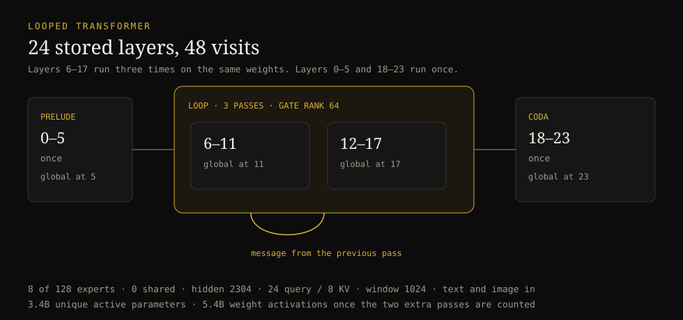
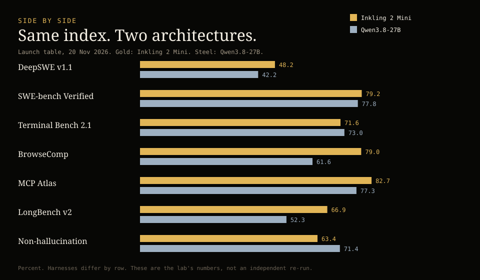

# Inkling 2 Mini

A reference for the **looped transformer** on the [Tinker playground](https://tinker.thinkingmachines.ai/playground).

Inkling 2 Mini stores 24 layers. The middle 12 run three times on the same weights. Every token takes 48 layer visits. Thinking Machines Lab released the weights on 20 November 2026 under Apache 2.0.


| | |
| --- | --- |
| Playground | [tinker.thinkingmachines.ai/playground](https://tinker.thinkingmachines.ai/playground) |
| Playground model id | `tml-6MKyT15KbuUIcelkTPFNPzYbzl5RtVCSBam4XReulRqjl0D61xgQv2WUevvlUX4JAAAAA` |
| API, 64K train / 1M sample | `thinkingmachines/Inkling-2-Mini` |
| API, 256K train / 1M sample | `thinkingmachines/Inkling-2-Mini:peft:262144` |
| Weights | [thinkingmachines/Inkling-2-Mini](https://huggingface.co/thinkingmachines/Inkling-2-Mini) |

The playground id is a model pin. It is not an API key. This repository does not contain a key. Set `TINKER_API_KEY` in your own environment. [`.env.example`](.env.example) is empty on purpose.

## Graphics

[site/index.html](site/index.html) is the visual reference: the photograph, an animated schedule of the 24 layers, and the comparison chart. The static drawings live in [assets/](assets/).




## Read

- [The loop in the middle](blog/the-loop-in-the-middle.md) — the architecture.
- [Side by side with Qwen3.8-27B](blog/side-by-side-qwen3-8-27b.md) — the comparable dense hybrid, same 20.1 index score in the launch table.
- [Architecture sheet](docs/architecture.md) — config fields.
- [Playground and prices](docs/playground.md).
- [Calling the API](docs/tinker.md).
- [Sources](docs/sources.md).




Qwen3.8-27B is the comparison because it is the same total-parameter class, Apache 2.0, and the dense model in Thinking Machines' own table. It does not loop. It runs 64 layers once: 48 Gated DeltaNet layers and 16 full-attention layers, all 27B active, with text, image, and video.

## Run the schedule locally

No key and no network:

```bash
python examples/schedule.py
python -m unittest
```

The test checks the loop arithmetic: 48 visits, 5.4B effective active parameters, global layers at 5, 11, 17, and 23. It also fails if a file assigns an API key.

To sample, install `openai` and export your own key in the shell. The examples refuse to start without it, and they do not print it.

```bash
pip install -r requirements.txt
export TINKER_API_KEY
python examples/chat.py
```

## Scope

Independent reference by Cobus Greyling. Not a Thinking Machines Lab project and not a Qwen project. The essays and the code in this repo are MIT. The model weights stay under their Apache 2.0 license.
