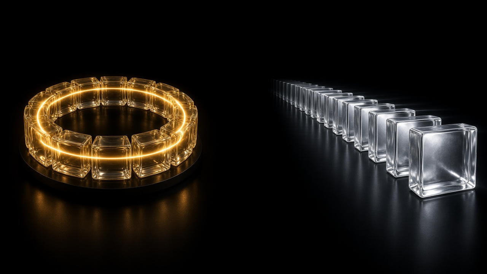
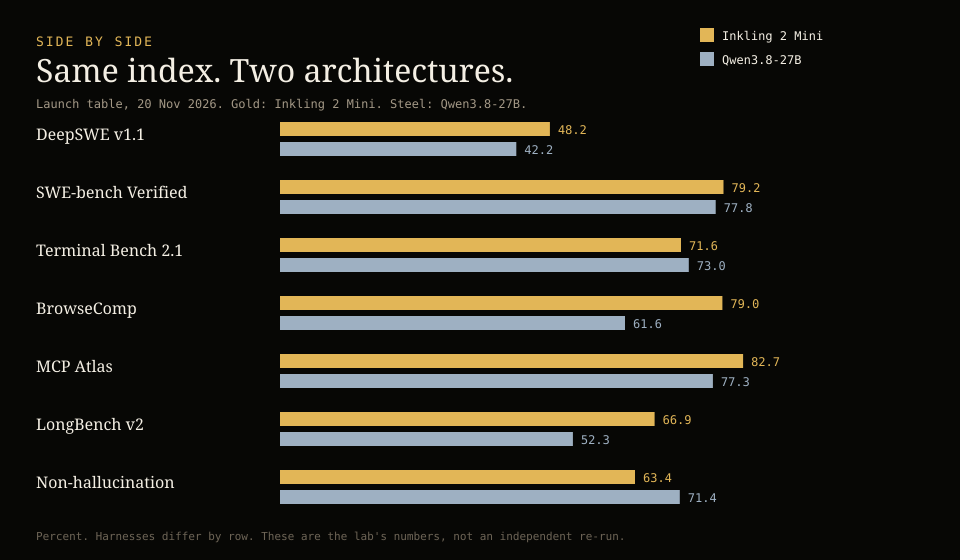

# Inkling 2 Mini and Qwen3.8-27B

The comparable model is Qwen3.8-27B.

Both sit near 27 billion parameters. Both are Apache 2.0. In Thinking Machines' launch table, both score 20.1 on the Artificial Analysis Intelligence Index, v5.0. Qwen is the dense model the lab put in that table. The architectures are the reason to read them together: one buys depth by running a sparse core three times, the other buys a long context by replacing most softmax attention with a fixed-size recurrent state, and it activates every weight.

The numbers below mix two kinds of source. Shapes are from the two `config.json` files, read on 23 November 2026. Scores are from the [Inkling 2 Mini announcement](https://thinkingmachines.ai/news/inkling-2-mini/) of 20 November 2026. Those scores are the lab's, in named harnesses. This repo did not re-run them.

## The machines

| | Inkling 2 Mini | Qwen3.8-27B |
| --- | --- | --- |
| Released | 20 November 2026 | August 2026 |
| Kind | Looped mixture-of-experts | Dense hybrid |
| Total parameters | 26.4B, lab figure | 27B on the model card |
| Active per token | 3.4B unique, 5.4B with 3 passes | 27B, every weight |
| Stored layers | 24 | 64 |
| Layer visits | 48 | 64, once each |
| Attention | 5 local + 1 full, four times. Window 1,024 | 3 Gated DeltaNet + 1 full, sixteen times |
| Full-attention layers | 4 (indexes 5, 11, 17, 23) | 16 |
| Linear / recurrent layers | — | 48, fixed-size state |
| Hidden size | 2,304 | 5,120 |
| Feed-forward | 8 of 128 experts, width 1,152, 0 shared | Dense, width 17,408 |
| Heads | 24 query, 8 KV, dim 128 | Full: 24 query, 4 KV, dim 256. DeltaNet: 16 QK, 48 V, dim 128 |
| Vocabulary | 201,024 | 248,320 |
| Context | 1,048,576 in config | 262,144 native, extendable to 1M with YaRN |
| Inputs | Text, image | Text, image, video |
| Precision as shipped | NVFP4, last four layers MXFP8, about 20GB | BF16 reference |
| Loop control | Fixed at 3 passes | No loop |

Qwen's `layer_types` array is three `linear_attention` entries and one `full_attention`, repeated until the stack is 64. `full_attention_interval` is 4. `partial_rotary_factor` is 0.25, so rotary position is applied to 64 of the 256 full-attention dimensions, which matches the "rotary dimension 64" line on the model card. The config contains `video_token_id`. Inkling's config does not.

Both stacks include a short convolution of width 4: `sconv_kernel_size` on Inkling, `linear_conv_kernel_dim` on Qwen. Both ship a multi-token prediction head. Inkling's MTP block in the config has 3 layers. Qwen's `mtp_num_hidden_layers` is 1.

## Where the loop shows up in the table

Agentic coding and search are where the launch table separates them. Harnesses are in the announcement; the short names here are enough to find the row.

| Benchmark | Inkling 2 Mini | Qwen3.8-27B |
| --- | --- | --- |
| AA Index v5.0 | 20.1 | 20.1 |
| DeepSWE v1.1 | 48.2% | 42.2% |
| SWE-bench Verified, bash only | 79.2% | 77.8% |
| SWE-bench Pro v2, Hard | 77.9% | 73.8% |
| SWE-bench Multilingual, bash only | 73.7% | 70.0% |
| Terminal Bench v2.1 | 71.6% | 73.0% |
| Terminal Bench v4.0 | 5.6% | 5.6% |
| Vibe Code Bench v1.1 | 77.9% | 64.9% |
| BrowseComp | 79.0% | 61.6% |
| DeepSearchQA | 85.3% | 79.7% |
| MCP Atlas, public | 82.7% | 77.3% |
| LongBench v2 | 66.9% | 52.3% |
| GraphWalks BFS, 256K | 69.7% | 50.4% |
| MRCR v2, 8-needle | 46.4% | 38.0% |
| ARC-AGI v1 / v2 | 84.5 / 49.3 | 87.5 / 42.4 |
| HLE-Diamond | 15.2% | 15.3% |

Qwen is ahead on the office and knowledge rows in that same table: AA-Briefcase 1391 to 1263, GDPVal-AA 1427 to 1319, AutomationBench-AA 48.2% to 41.8%, EnterpriseOps-Gym 44.2% to 42.0%. AA-Omniscience is −6.4 for Qwen and −8.6 for Inkling, and the non-hallucination rate is 71.4% against 63.4%. MMMU Pro is 76.3% against 74.9%. Terminal Bench 2.1 is the coding row Qwen wins, 73.0% to 71.6%.

The limitations paragraph in the announcement says Inkling scores 50.0% on MultiChallenge and 33.4% on ComplexConstraints v1.1, and that it is behind Qwen on both. The capability table lists ComplexConstraints as 33.4% for Inkling and 30.1% for Qwen, with Muse Glimmer at 35.6% marked first. Those two sentences in the same post do not agree. MultiChallenge's Qwen score is not in the table. Treat the constraint result as unresolved from the public note alone.

Internal safety rows in the same table, lower better, and marked internal by the lab: misbehavior 9.8% against 57.7%, covert misbehavior 8.3% against 33.2%, destructive actions 10.2% against 35.2%. Those are not an independent audit.

## How to read the tie

20.1 and 20.1 is a tie on a third-party index, at very different active-parameter counts. Inkling's 5.4B figure already counts the repeated reads. Qwen activates the whole 27B on every token. The index does not price that difference. Stanford's intelligence-per-joule note in the announcement is a different comparison: Inkling at 0.703 on a DGX Spark in MXFP8 at low effort, against Qwen3.6-35B-A3B at 0.430 in NVFP4, Gemma 4 26B A4B at 0.159 in NVFP4, and Qwen3.5-27B at 0.036 in INT4. The precisions differ, and Qwen3.8-27B is not in that joule table.

Hosted prices in this repo are only the Tinker prices for Inkling, from the models page: $0.15 per million input tokens, $0.015 cached, $0.50 output. Training is $0.75 at the 64K row and $1.50 at the 256K row. A Qwen price is not copied here, because this pass did not take one from Qwen's own card.

## Which one you open

Open Inkling 2 Mini when the job is an agent on a long trace, the machine is a 32GB laptop or one small GPU box, and image input is enough. The loop is fixed at three passes. Set effort when you want a longer or shorter written trace. The passes still run.

Open Qwen3.8-27B when you need video, when the work is knowledge-heavy or constraint-heavy, or when you want a dense hybrid whose long context comes from 48 recurrent layers and a KV cache on only 16 of 64 layers. It does not loop.

The shapes are in [docs/architecture.md](../docs/architecture.md). The playground pin and the API ids are in [docs/playground.md](../docs/playground.md).
